# Dengue Symptoms, Fever and Exposure Factors Among Survey Participants in Bangladesh

BDS3106 Programming for Data Science | Mid-Term Project, Phase I | Fall 2026-2027
Department of Data Science, American International University-Bangladesh (AIUB)

A descriptive exploratory data analysis (EDA) of a public survey dataset (n = 1,018) that compares participants with a recorded
dengue-positive and a recorded dengue-negative test result.

**[Read the project report (PDF, 5 pages)](https://github.com/itzmubzy/dengue-symptom-exposure-analysis/blob/main/report/Dengue_Midterm_Project_Report_Updated.pdf)**
| [Download the PDF](https://github.com/itzmubzy/dengue-symptom-exposure-analysis/raw/main/report/Dengue_Midterm_Project_Report_Updated.pdf)
| [Open the notebook](https://github.com/itzmubzy/dengue-symptom-exposure-analysis/blob/main/notebooks/Dengue_Symptom_and_Exposure_Analysis.ipynb)

> **Scope.** The analysis is descriptive only. It does not diagnose dengue, establish causes, test statistical significance,
> or estimate dengue prevalence in Bangladesh.

## Project overview

The project examines how fever characteristics, early symptoms, pain scores, vomiting frequency and reported exposures differ
between the two recorded test-result groups, after a documented data-quality audit.

**Research objectives**
1. Inspect the raw data, document its quality problems and justify each cleaning decision.
2. Compare fever duration and maximum temperature by recorded test result.
3. Describe early-symptom, pain-score and vomiting differences between the groups.
4. Describe how the positive share varies with exposure factors and state the limits of these comparisons.

**Research questions**
- **RQ1:** How do fever duration and maximum temperature differ between the two groups?
- **RQ2:** Which of the eight early symptoms show the largest difference in frequency?
- **RQ3:** How do the four pain scores (0-10) and daily vomiting episodes differ?
- **RQ4:** How does the positive proportion vary with household exposure, stagnant water, area type and previous dengue infection?

## Analytical pipeline

```mermaid
flowchart LR
    S1["Stage 1<br/>Data Acquisition"]:::data --> S2["Stage 2<br/>Data Understanding"]:::data --> S3["Stage 3<br/>Initial EDA"]:::eda --> S4["Stage 4<br/>Quality Audit"]:::qa --> S5["Stage 5<br/>Cleaning"]:::qa --> S6["Stage 6<br/>Verification"]:::ver --> S7["Stage 7<br/>RQ-focused EDA"]:::ana --> S8["Stage 8<br/>Reporting"]:::rep

    classDef data fill:#DCEBFA,stroke:#1F5FA8,stroke-width:3px,color:#000
    classDef eda fill:#DDF3E4,stroke:#1E7B3C,stroke-width:3px,color:#000
    classDef qa fill:#FDE8CF,stroke:#C46A00,stroke-width:3px,color:#000
    classDef ver fill:#EADCF5,stroke:#6A2C91,stroke-width:3px,color:#000
    classDef ana fill:#FFF4C2,stroke:#9A7B00,stroke-width:3px,color:#000
    classDef rep fill:#F8D9D9,stroke:#A32020,stroke-width:3px,color:#000
```



Colour key: blue = data, green = exploration, orange = audit and cleaning, purple = verification, yellow = analysis, red = reporting.

| Stage | Name | What is done |
|---|---|---|
| 1 | Data Acquisition | Load the Mendeley survey CSV (1,018 rows, 23 variables); the raw file is kept read-only |
| 2 | Data Understanding | Group the variables, note bilingual (English-Bengali) labels and temperature stored as text |
| 3 | Initial EDA (raw) | Median, IQR, skewness, histograms, scatterplots and Spearman correlations |
| 4 | Data-Quality Audit | Check missing values, duplicates, temperature and district entries, and "Not sure" answers |
| 5 | Non-destructive Cleaning | Apply fixes to a separate working copy; no rows deleted, no values imputed |
| 6 | Verification | Integrity assertions: 1,018 rows kept, districts reduced from 28 to 18, raw data unchanged |
| 7 | Question-focused EDA | RQ1-RQ4 summaries by recorded result (medians, IQR, percentage-point differences, positive share) |
| 8 | Interpretation and Reporting | State limitations, keep claims descriptive, publish notebook and report |

## Dataset

| Item | Detail |
|---|---|
| Title | Early Detection of Dengue Infection Using Machine Learning: A Survey Dataset from Bangladesh |
| Authors | Md Niazul Islam Naim, Abir Hasan |
| Source | Mendeley Data, Version 1: https://data.mendeley.com/datasets/t2h5528tc4/1 |
| DOI | https://doi.org/10.17632/t2h5528tc4.1 |
| Licence | CC BY 4.0 (attribution required) |
| Size | 1,018 rows, 23 columns (630 positive, 388 negative) |
| File used | `Dengue_Raw_Research_Data_v1.csv` (not redistributed in this repository) |

**Ethics and data use.** The file has no names or contact details. Answers are self-reported, test results were not verified
against laboratory records, and consent responses were removed from the public file. 23 participants are under 18, so results
are reported in aggregate and not for very small groups. The sample is not random (about 71% Dhaka, 75% male, 82% urban), and
the positive share (61.89%) describes the sample, not national prevalence. Please cite the dataset when reusing it.

## Key results (descriptive, unadjusted)

| Question | Main observation |
|---|---|
| RQ1 | Median fever duration 7 vs 6 days (positive vs negative); median maximum temperature 104 vs 102 °F (99-106 °F subset, n = 1,002). Including the two 107 °F values leaves both medians unchanged. |
| RQ2 | Largest positive-minus-negative differences: appetite loss (+69.31 pp), fatigue (+58.70 pp), nausea (+33.01 pp). Abdominal pain (-32.85 pp), diarrhea (-21.84 pp) and chills (-11.46 pp) were more frequent in the negative group. |
| RQ3 | Higher medians in the positive group for all four pain scores (e.g. headache 10 vs 7) and for vomiting episodes per day (3 vs 0). |
| RQ4 | Positive share: household exposure 70.45% vs 59.03%; stagnant water 63.05% vs 51.45%; previous dengue 70.31% vs 61.32%; area type 62.84% (urban), 60.00% (rural), 55.21% (semi-urban). |

These are associations in this sample only and are not tested for statistical significance.

## Folder structure

```
dengue-symptom-exposure-analysis/
|-- README.md
|-- requirements.txt
|-- report/
|   `-- Dengue_Midterm_Project_Report_Updated.pdf
|-- notebooks/
|   `-- Dengue_Symptom_and_Exposure_Analysis.ipynb
`-- data/
    |-- raw/
    |   `-- Dengue_Raw_Research_Data_v1.csv      (download from the Mendeley link above)
    `-- Dengue_working_copy.csv                  (created by the notebook)
```

## How to run

1. Install Python 3.10 or newer.
2. Install the dependencies from the project folder:
   ```
   python -m pip install -r requirements.txt
   ```
3. Download the raw CSV from the Mendeley link above and save it as `data/raw/Dengue_Raw_Research_Data_v1.csv`.
4. Start Jupyter and open the notebook:
   ```
   python -m jupyter notebook notebooks/Dengue_Symptom_and_Exposure_Analysis.ipynb
   ```
5. Run all cells from top to bottom (Kernel > Restart & Run All). The notebook builds every file path relative to the
   project folder, so no paths need editing. The cleaned working copy is written to `data/Dengue_working_copy.csv`.

## What the notebook contains

| Section | Content | Pipeline stage |
|---|---|---|
| 1-3 | Problem, research objectives and questions, dataset and ethics | 1 |
| 4-5 | Setup, loading the raw CSV, data understanding | 1-2 |
| 6 | Data exploration of the raw data: descriptive summary and visual summary | 3 |
| 7 | Data cleaning: inspect and count issues, apply fixes on a copy, verify, save | 4-6 |
| 8 | Analysis of RQ1-RQ4 (tables, charts, findings) | 7 |
| 9-11 | Preliminary findings, limitations, next steps; references follow | 8 |

## Key cleaning decisions

- The raw DataFrame is never changed; all fixes are applied to a copy.
- 300 district values are standardised (296 trailing spaces and 4 spelling variants), reducing 28 raw categories to 18; the
  original is kept in `district_original`.
- Temperature text is converted to a numeric `temp_f` column; 12 blanks, 1 text entry and 1 implausible value (8 °F) stay
  unchanged and are not imputed.
- The RQ1 temperature comparison uses 99-106 °F, a data-quality window (not a clinical fever definition) described in
  Section 8.2 of the notebook, with a 99-107 °F sensitivity check.
- No rows are deleted. "Not sure" answers are kept as their own category and never merged with "No".

## Limitations

Self-reported data with possible recall bias; unverified test results and unknown test type or timing; a non-random sample
concentrated in Dhaka; small subgroups (e.g. previous dengue n = 64); no confidence intervals, significance tests or
adjustment for other variables. Possible Phase II extensions include effect sizes, Mann-Whitney U and chi-square tests with
multiple-comparison correction, and sensitivity analyses of "Not sure" handling.

## Dependencies

Listed in `requirements.txt`: pandas, numpy, matplotlib, seaborn and Jupyter.

## Team contributions

<!-- Confirm that each description matches the work the member actually completed before submitting. -->

| Member | Student ID | Contribution |
|---|---|---|
| SAMIA AKTER | 24-58809-2 | RQ1 fever and temperature analysis (data filtering, sensitivity checks, descriptive statistics, boxplots); research problem, objectives and methods; report integration and review |
| MD SALEH ABID | 24-58816-2 | Dataset provenance, licensing and ethics; exposure-category checks; RQ4 analysis (cross-tabulations, percentages, charts); sources and final report review |
| MD RYAN HAQUE JIM | 24-58216-2 | Pain and vomiting variables; data dictionary; missing-value, duplicate, outlier and cleaning checks; RQ3 analysis; preprocessing documentation |
| K M MUBIN | 24-57300-2 | Early-symptom variables; symptom summaries; RQ2 frequency and percentage comparisons and charts; notebook organisation, GitHub documentation and reproducibility review |

## References

1. World Health Organization. (2025). Dengue and severe dengue: Fact sheet. https://www.who.int/news-room/fact-sheets/detail/dengue-and-severe-dengue
2. Hasan, M. N., Rahman, M., Uddin, M., et al. (2025). The 2023 fatal dengue outbreak in Bangladesh highlights a paradigm shift of geographical distribution of cases. *Epidemiology and Infection, 153*, e3. https://doi.org/10.1017/S0950268824001791
3. Naim, M. N. I., & Hasan, A. (2026). Early Detection of Dengue Infection Using Machine Learning: A Survey Dataset from Bangladesh (Version 1). Mendeley Data. https://doi.org/10.17632/t2h5528tc4.1
